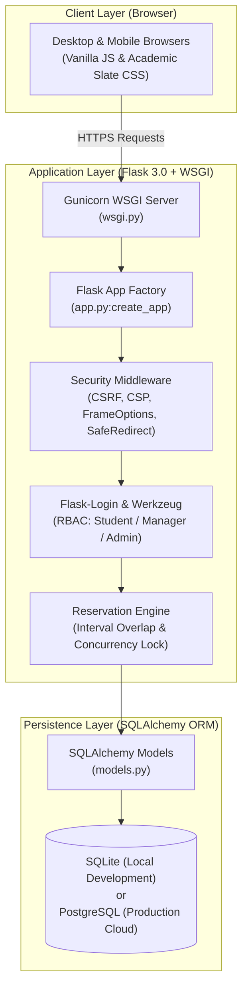

# 🌉 ResourceBridge

> **Campus Resource Sharing Network with Trust, Safety, and Physical Accountability**
> *A secure, production-ready Flask application designed for higher-education equipment and laboratory facility sharing.*

[](https://resourcebridge-79f6.onrender.com)
[](https://resourcebridge-79f6.onrender.com/health)
[]()
[]()
[]()
[]()

---

## 📑 Table of Contents

1. [Project Overview](#1-project-overview)
2. [Problem Statement](#2-problem-statement)
3. [Solution](#3-solution)
4. [Target Users and Use Cases](#4-target-users-and-use-cases)
5. [Key Features](#5-key-features)
6. [User Workflow](#6-user-workflow)
7. [Technology Stack and Architecture](#7-technology-stack-and-architecture)
8. [Installation and Local Setup](#8-installation-and-local-setup)
9. [Demo and Test Instructions](#9-demo-and-test-instructions)
10. [Deployment](#10-deployment)
11. [Testing and Quality Assurance](#11-testing-and-quality-assurance)
12. [Known Limitations and Future Improvements](#12-known-limitations-and-future-improvements)
13. [AI Assistance and Development Disclosure](#13-ai-assistance-and-development-disclosure)
14. [Project Structure and Contribution Information](#14-project-structure-and-contribution-information)

---

## 1. Project Overview

**ResourceBridge** is a campus resource-sharing and facility stewardship web application built with Python and Flask. It provides university communities with a centralized platform to discover, schedule, borrow, and inspect high-value equipment and specialized spaces. By replacing informal paper sign-up sheets and fragmented departmental emails with verified digital custody, automated interval-conflict checking, and condition reports, ResourceBridge bridges the gap between campus resources and student innovation.

---

## 2. Problem Statement

Across higher education institutions, millions of dollars worth of advanced academic assets—such as **cinema cameras, laser cutters, 3D printers, deep-learning GPU servers, audio recording booths, and robotics workbenches**—remain underutilized behind locked departmental doors.

Simultaneously, students working on capstone projects, research publications, and creative portfolios struggle to access these resources due to:
- **Departmental Silos**: Equipment is often restricted to specific degree programs or physical buildings without cross-campus visibility.
- **Informal Paper Logs**: Clipboards and manual sign-out sheets lead to lost accessories, untracked damage, and zero accountability.
- **Scheduling Conflicts**: Accidental double-bookings disrupt lab sessions and waste valuable student and faculty time.
- **Reluctance to Loan**: Facility managers hesitate to lend sensitive instruments without verifiable condition check-in and intake inspections.

---

## 3. Solution

ResourceBridge resolves these campus sharing challenges through an accountable lending workflow:
- **Centralized Campus Catalog**: Students search and filter all institutional equipment and bookable rooms in one place, with transparent visibility into safety prerequisites and location.
- **Automated Scheduling Engine**: Prevents double-booking via temporal overlap algorithms, enforces maximum borrowing limits (14 days), and checks asset operating status.
- **Two-Point Physical Custody Inspections**: Facility managers file digital **Check-In** and **Return Condition Reports** (scoring physical condition 1–5 with mandatory notes) to guarantee fair, tamper-evident accountability.
- **Incident Escalation**: Borrowers and managers can log formal incident tickets for equipment malfunctions or transit damage, tracked through administrative resolution.
- **Role-Based Security**: Complete access segregation among students, departmental custodians, and campus administrators.

---

## 4. Target Users and Use Cases

ResourceBridge supports three distinct campus roles:

| Role | Primary User Group | Core Responsibilities & Use Cases |
| :--- | :--- | :--- |
| **Student (Borrower)** | Enrolled undergraduates, graduate researchers, student organizations | • Browse catalog by keyword, location, and category.<br>• Submit booking requests for academic projects.<br>• Track active loans and scheduled return deadlines.<br>• Report equipment defects or damage incidents. |
| **Facility Manager (Custodian)** | Lab directors, shop technicians, faculty advisors | • Review, approve, or reject reservation requests for their department.<br>• Conduct physical handover check-in with condition reports.<br>• Perform intake return inspections.<br>• Investigate and resolve incident tickets. |
| **Campus Administrator (Auditor)** | Department chairs, safety officers, IT/operations directors | • Maintain institution-wide inventory (create, edit, retire resources).<br>• Access complete chronological audit logs for all bookings.<br>• Monitor platform health, dispute rates, and asset utilization. |

---

## 5. Key Features

Every feature listed below is fully implemented and backed by automated test coverage:

- **Authentication & Role-Based Access Control**:
  - Secure registration restricted to verified student accounts (`role='student'`).
  - Salted password hashing via Werkzeug (`scrypt` / `pbkdf2:sha256`).
  - Context-aware session management with `@login_required`, `@manager_required`, and `@admin_required` route guards.
- **Resource Discovery & Catalog**:
  - Full-text search matching asset title and description.
  - Multi-criteria filtering by Category (Audio/Video, Lab Equipment, Computing, Workshop, Space) and Campus Building Location.
  - Asset type segmentation (`equipment` vs. `space`).
  - Clear display of safety rules, prerequisites, and custodian contact information.
- **Conflict-Aware Booking Engine**:
  - Mathematical temporal interval validation: `(existing_start < requested_end) and (existing_end > requested_start)`.
  - Automatic rejection of requests for inactive or maintenance-flagged assets.
  - Maximum duration enforcement (up to 14 days).
  - Thread-synchronized approval execution (`threading.Lock`) preventing double-booking race conditions.
- **Physical Accountability & Condition Reports**:
  - Mandatory handover check-in report before an asset is released.
  - Mandatory return inspection report before a booking is closed.
  - 1-to-5 condition rating scale (`excellent`, `good`, `fair`, `poor`) with mandatory descriptive notes.
- **Incident Management**:
  - Digital incident submission linked directly to specific bookings and resources.
  - Severity tracking and administrative status updates (`open`, `under_review`, `resolved`).
- **Immutable Audit History**:
  - Centralized `BookingAuditLog` capturing timestamps, acting user ID, prior status, new status, and action summaries.

---

## 6. User Workflow

The platform guides users through an end-to-end borrowing lifecycle:

```
[1. Register / Sign In]
         │
         ▼
[2. Discover Resource]  ──►  Filter by Category & Campus Building
         │
         ▼
[3. Submit Reservation]  ──►  Select Start/End Timestamps (<= 14 Days)
         │
         ▼
[4. Manager Review]      ──►  Approve / Reject with Reason
         │ (Approved)
         ▼
[5. Physical Check-In]   ──►  Custodian Handover & Condition Report #1
         │
         ▼
[6. Active Loan Custody] ──►  Student Uses Asset for Academic Work
         │
         ▼
[7. Physical Return]     ──►  Intake Inspection & Condition Report #2
         │
         ▼
[8. Closed / Incident]   ──►  Asset Restocked; Optional Incident Escalation
```

---

## 7. Technology Stack and Architecture

ResourceBridge is built on a clean, maintainable, dependency-light Python web architecture:

- **Web Framework**: Flask 3.0+ (Application Factory pattern in `app.py`)
- **Language**: Python 3.10+ (Tested through Python 3.14)
- **Database & ORM**: SQLAlchemy 3.1+ (SQLite default; PostgreSQL-ready)
- **Authentication**: Flask-Login 0.6+ and Werkzeug Security
- **Production Server**: Gunicorn 21.2+ (`--workers 1 --threads 4 --timeout 60`) / Waitress WSGI
- **Templating**: Jinja2 (HTML5 with automatic contextual XSS escaping)
- **Design System**: Custom Academic Slate CSS (no heavy external CSS frameworks or CDNs)
- **Client Scripting**: Vanilla JavaScript ES6 (1-click demo selectors, mobile navigation toggling)
- **Testing**: Pytest 9.1+ and Playwright Chromium real browser automation

### System Architecture Diagram



---

## 8. Installation and Local Setup

### Prerequisites
- **Python 3.10 or higher**
- **pip** package manager
- **Git**

### Step 1: Clone the Repository
```bash
git clone https://github.com/syedhamzah-dev/resourcebridge.git
cd resourcebridge
```

### Step 2: Create and Activate Virtual Environment
**On Linux/macOS:**
```bash
python3 -m venv venv
source venv/bin/activate
```
**On Windows (PowerShell):**
```powershell
python -m venv venv
.\venv\Scripts\Activate.ps1
```

### Step 3: Install Dependencies
```bash
pip install -r requirements.txt
```

### Step 4: Configure Environment Variables (Optional)
The application works out of the box with safe local defaults. To customize secrets:
```bash
# On Linux/macOS
cp .env.example .env

# On Windows (PowerShell)
copy .env.example .env
```

### Step 5: Initialize and Seed the Database
Initialize the database tables and populate sample demonstration data:
```bash
python seed_demo.py
```
*(Alternatively, you can run `flask init-db` followed by `flask seed`)*

### Step 6: Run the Local Development Server
```bash
python app.py
```
*Or via the production WSGI runner:*
```bash
python wsgi.py
```
Open your web browser and navigate to:
👉 **`http://127.0.0.1:5000`**

---

## 9. Demo and Test Instructions

For evaluation, presentations, and hackathon judging, the database includes three pre-configured accounts:

> ⚠️ **DEMONSTRATION USE ONLY**: The credentials below are provided strictly for local evaluation and hackathon testing. Never use production secrets or real passwords.

| Role | Account Name | Email | Password | Primary Workflow to Test |
| :--- | :--- | :--- | :--- | :--- |
| **Student** | Alex Rivera | `student@campus.edu` | `StudentPass123!` | Browse catalog, submit booking request, view booking status. |
| **Manager** | Dr. Elena Vance | `manager@campus.edu` | `ManagerPass123!` | Review pending requests, approve booking, conduct check-in and return. |
| **Admin** | Marcus Brody | `admin@campus.edu` | `AdminPass123!` | Manage catalog resources, review institutional audit log, check platform metrics. |

### ⚡ 1-Click Evaluation
On the **Sign In** screen (`/login`), click any of the **1-Click Demo Profile** buttons to automatically fill the credentials and sign in instantly without typing.

### Step-by-Step Demonstration Script
1. **Student Request**: Sign in as `student@campus.edu`. Go to `/resources`, select **Sony FX6 Cinema Camera**, and submit a booking request for tomorrow 10:00–14:00. Status becomes `pending`. Sign out.
2. **Manager Approval & Check-In**: Sign in as `manager@campus.edu`. Navigate to `/manager/bookings`, locate Alex's request, and click **Approve**. Click **Check-In Resource**, rate the initial physical condition (e.g., 5/5, "Pristine condition"), and confirm. Status becomes `checked_in`.
3. **Manager Return**: On the same booking detail page, click **Return Resource**, enter the intake condition (e.g., 4/5, "Minor tripod plate wear"), and submit. Status transitions to `returned`.
4. **Admin Audit**: Sign in as `admin@campus.edu`. Open `/dashboard` to review campus-wide utilization, and inspect the chronological event log on the booking detail page.

---

## 10. Deployment

ResourceBridge is deployed and publicly accessible for hackathon judging:

- **Verified Live URL**: 👉 **[https://resourcebridge-79f6.onrender.com](https://resourcebridge-79f6.onrender.com)**
- **Health Check Endpoint**: [https://resourcebridge-79f6.onrender.com/health](https://resourcebridge-79f6.onrender.com/health)
  *Returns `HTTP 200 OK`: `{"status": "healthy", "database": "connected"}`*
- **Hosting Platform**: Render.com (Web Service connected to GitHub repository `main` branch)
- **WSGI Server**: Gunicorn 21.2.0 (`web: gunicorn wsgi:app --workers 1 --threads 4 --timeout 60`)
- **Runtime**: Python 3.11.8 (`runtime.txt`)
- **Transport Security**: Enforced TLS/HTTPS, `SESSION_COOKIE_SECURE=True`, `HttpOnly`, `SameSite=Lax`

### Production Environment Variables Reference

| Variable | Required? | Production Value | Description |
| :--- | :---: | :--- | :--- |
| `FLASK_ENV` | **Yes** | `production` | Enforces production mode, disables debugger, activates secure cookie defaults. |
| `SECRET_KEY` | **Yes** | *(64-char hex string)* | Cryptographic key for session signing and CSRF tokens. Application halts if missing in production. |
| `SESSION_COOKIE_SECURE` | **Yes** | `true` | Restricts session cookies strictly to HTTPS connections. |
| `DATABASE_URL` | Optional | `postgresql://...` | Connection URI. Defaults to local SQLite if omitted. Automatically normalizes legacy `postgres://` prefixes. |
| `PYTHON_VERSION` | Optional | `3.11.8` | Target Python runtime for buildpacks. |

---

## 11. Testing and Quality Assurance

The application is validated across three testing layers:

### A. Automated Test Suite (70 Tests Passing)
Run the complete automated test suite locally:
```bash
python -m pytest -v
```

```text
============================= test session starts =============================
platform win32 -- Python 3.14.6, pytest-9.1.1, pluggy-1.7.0
rootdir: C:\Users\mohdh\Desktop\Projects\resourcebridge
plugins: anyio-4.15.1, Faker-40.43.0, platformdirs-4.13.4, asyncio-1.4.0, cov-7.1.0
collected 70 items

tests\test_auth.py ............                                          [ 17%]
tests\test_bookings.py ................                                  [ 40%]
tests\test_frontend.py .....                                             [ 47%]
tests\test_lifecycle.py ...........                                      [ 62%]
tests\test_resources.py ...............                                  [ 84%]
tests\test_security.py ...........                                       [100%]

============================= 70 passed in 31.51s =============================
```

**Coverage Breakdown**:
- `test_auth.py` (12 tests): Password hashing, role escalation rejection, CSRF token presence, public registration, first-login vs. returning greetings, email pre-fill.
- `test_bookings.py` (16 tests): Duration limits (<=14 days), forward-looking dates, status transitions, approval authorization, multi-user conflict rejection.
- `test_frontend.py` (4 tests): WCAG contrast, responsive layout markers, 1-click demo helpers, about page milestones.
- `test_lifecycle.py` (11 tests): Check-in and return condition reports, note requirements, privacy isolation between students, incident reporting.
- `test_resources.py` (15 tests): Catalog searching, category filtering, building location filtering, manager inventory CRUD, empty states.
- `test_security.py` (12 tests): HTTP defense headers (`nosniff`, `SAMEORIGIN`), safe open redirect validation, custom 403/404/500 handlers, multithreaded concurrency mutex lock.

### B. Local Real Browser Automation (Playwright Chromium)
Verified through real, automated headless Chromium browser execution against `http://127.0.0.1:5001`:
1. Registered brand-new student account (`local_browser_*@campus.edu`).
2. Confirmed successful account creation alert and pre-filled email.
3. Verified initial login greeting: *"Welcome to ResourceBridge, \<Name\>!"*.
4. Signed out and terminated browser context.
5. Opened fresh browser session; verified returning greeting: *"Welcome back, \<Name\>!"*.
6. Terminated and restarted the Flask application process.
7. Verified persistent sign-in after server restart with SQLite.

### C. Deployed Live Browser Automation (Playwright Chromium on Render)
Verified through real automated Chromium browser execution against `https://resourcebridge-79f6.onrender.com`:
1. Navigated to live `/register` endpoint.
2. Registered live user (`browser_user_*@campus.edu`).
3. Verified post-registration redirect with pre-filled email and success flash alert.
4. Completed first login; verified *"Welcome to ResourceBridge"* greeting and dashboard access.
5. Signed out and closed browser context.
6. Opened fresh browser session (Context 2) with clean cookie jar; verified successful login with *"Welcome back"*.
7. Tested bad-password attempt in Context 3; verified rejection with *"Invalid email or password"*.

---

## 12. Known Limitations and Future Improvements

### Genuine Technical Disclosures

1. **Cloud Ephemeral Filesystem on Render Free Tier**:
   - **How it works**: Render's free Web Service runs inside ephemeral Docker containers without persistent disk storage. When the container spins down due to 15 minutes of inactivity or when a new commit is pushed, Render provisions a fresh container layer.
   - **Built-in Safety**: On startup, `wsgi.py` automatically initializes tables and seeds the 3 demo accounts (`student@campus.edu`, `manager@campus.edu`, `admin@campus.edu`), ensuring hackathon evaluators can always access and test the live application.
   - **Permanent PostgreSQL Solution**: For permanent persistence of all newly registered users and custom bookings across container restarts, connect a managed PostgreSQL instance:
     1. In Render Dashboard, click **New +** $\rightarrow$ **PostgreSQL** (Free plan).
     2. Copy the **Internal Database URL**.
     3. Add environment variable `DATABASE_URL` to your Web Service. ResourceBridge automatically rewrites `postgres://` to `postgresql://` and connects seamlessly without code changes.

2. **Process-Level Concurrency Scope**:
   - The double-booking prevention engine uses an in-memory `threading.Lock` within `app.py`. Running Gunicorn with `--workers 1 --threads 4` guarantees that all concurrent requests on a single container are processed safely.
   - In horizontally scaled multi-worker environments (`gunicorn -w 4`) or multi-server clusters, database-level row locking (`SELECT ... FOR UPDATE`) or a Redis distributed lock should be used.

### Realistic Future Improvements
- **Automated Notifications**: Email or SMS alerts for booking approvals, scheduled return reminders, and overdue equipment notices.
- **QR Code Physical Handover**: Mobile camera QR scanning during physical check-in and return to instantly bring up the condition report form.
- **Calendar Integration**: Export approved reservations to iCalendar (`.ics`) and Google Calendar.
- **Institutional Single Sign-On (SSO)**: SAML 2.0 / OAuth2 integration with university campus directories.

---

## 13. AI Assistance and Development Disclosure

In accordance with hackathon competition rules and transparency best practices:

- **Human Author & Engineering Lead**: Syed Mohammad Hamzah.
  - Drove all problem discovery, system architecture, database schema design, business rule constraints, security policies, verification strategy, and final code reviews.
- **AI Pair Programming Assistant**: Google Antigravity (powered by DeepMind Gemini models).
  - Assisted with writing repetitive boilerplate, expanding pytest test fixtures, authoring CSS design tokens, diagnosing edge cases in authentication redirects, and automating Playwright browser test scripts.
- **Verification & Oversight**: Every line of code, template element, test case, and documentation deliverable was reviewed, tested, and validated by the human developer. All automated tests (70 passing) and real browser tests were executed and confirmed.

---

## 14. Project Structure and Contribution Information

### Directory Layout
```text
resourcebridge/
├── app.py                  # Flask Application Factory, routes, error handlers, CLI commands
├── models.py               # SQLAlchemy models (User, Resource, Booking, ConditionReport, Incident, AuditLog)
├── seed_demo.py            # Standalone demonstration database initialization script
├── wsgi.py                 # Production WSGI entrypoint with auto-seeding
├── Procfile                # Render/Heroku process configuration (Gunicorn command)
├── runtime.txt             # Python runtime specification (python-3.11.8)
├── requirements.txt        # Pinned project dependencies
├── .env.example            # Environment variable template
├── .gitignore              # Git ignore rules (excludes SQLite files, caches, virtualenvs)
├── templates/              # Jinja2 HTML templates
│   ├── base.html           # Master layout with responsive navbar and flash alerts
│   ├── index.html          # Public landing page with featured resources
│   ├── about.html          # Campus sharing mission and roadmap
│   ├── login.html          # Sign-in form with 1-Click Demo Profiles
│   ├── register.html       # Student registration form
│   ├── dashboard.html      # Role-aware dashboard with live statistics
│   ├── resources/          # Catalog browse, detail, and inventory management
│   └── bookings/           # Reservation requests, manager queues, condition reports
├── static/
│   ├── css/style.css       # Academic Slate design system (high-contrast, responsive)
│   └── js/main.js          # Demo autofill and UI interaction scripts
├── tests/                  # Automated pytest test suites (70 tests)
│   ├── test_auth.py        # Authentication and registration tests
│   ├── test_bookings.py    # Booking engine and conflict tests
│   ├── test_frontend.py    # UI layout and accessibility tests
│   ├── test_lifecycle.py   # Check-in, return, and incident tests
│   ├── test_resources.py   # Catalog and inventory CRUD tests
│   └── test_security.py    # Security headers, cookies, CSRF, and concurrency tests
└── reports/                # Local evidence package (excluded from Git)
    ├── PROJECT_SUMMARY.md  # Detailed summary dossier with issue audit
    └── ResourceBridge_Submission_Summary.pdf # Formatted submission summary PDF
```

### Contributing & Reporting Issues
1. Fork the repository and create a feature branch (`git checkout -b feature/amazing-feature`).
2. Run the test suite (`python -m pytest`) to ensure all 70 tests pass without regression.
3. Commit your changes with clear semantic messages (`git commit -m "feat: add amazing feature"`).
4. Push to your branch (`git push origin feature/amazing-feature`) and open a Pull Request.
5. To report a bug or request an enhancement, please open an Issue on [GitHub](https://github.com/syedhamzah-dev/resourcebridge/issues).

---

## 📜 License

This project is licensed under the **MIT License** — see the LICENSE file for details. Built for educational and hackathon demonstration purposes.
